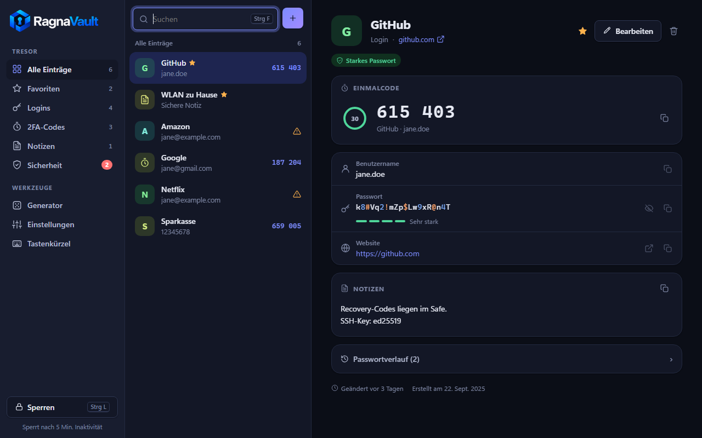
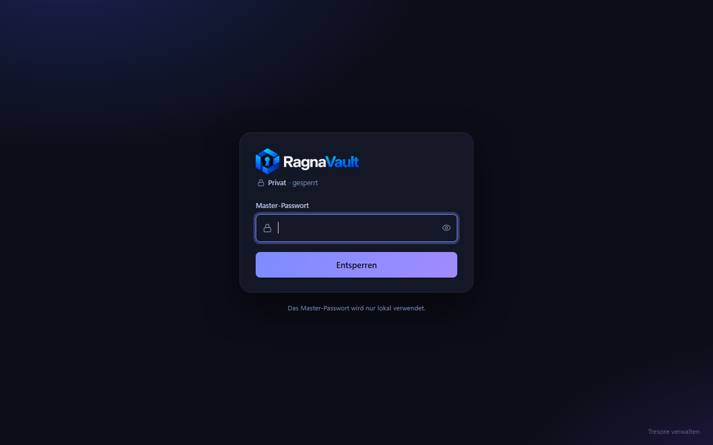
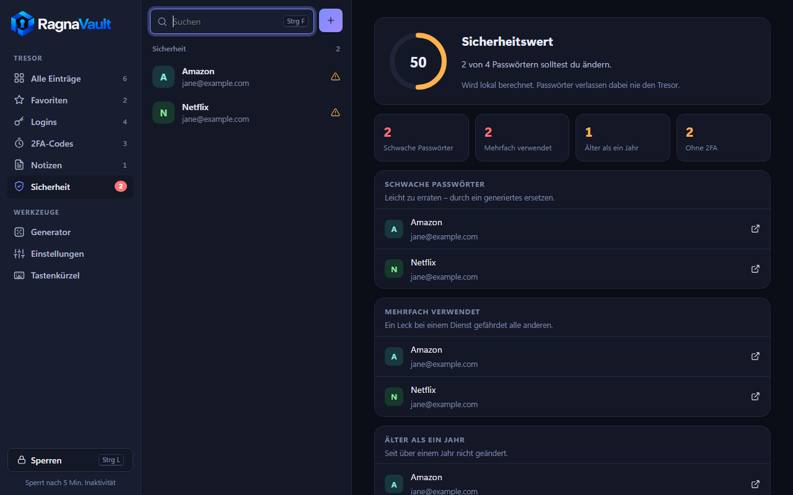
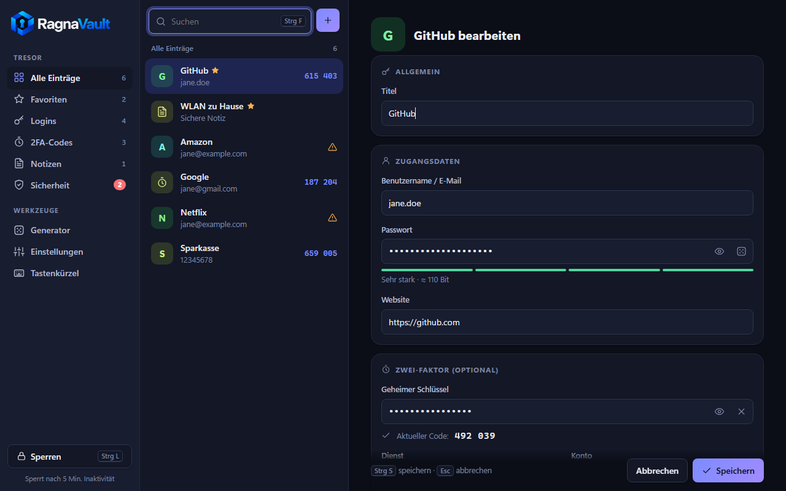
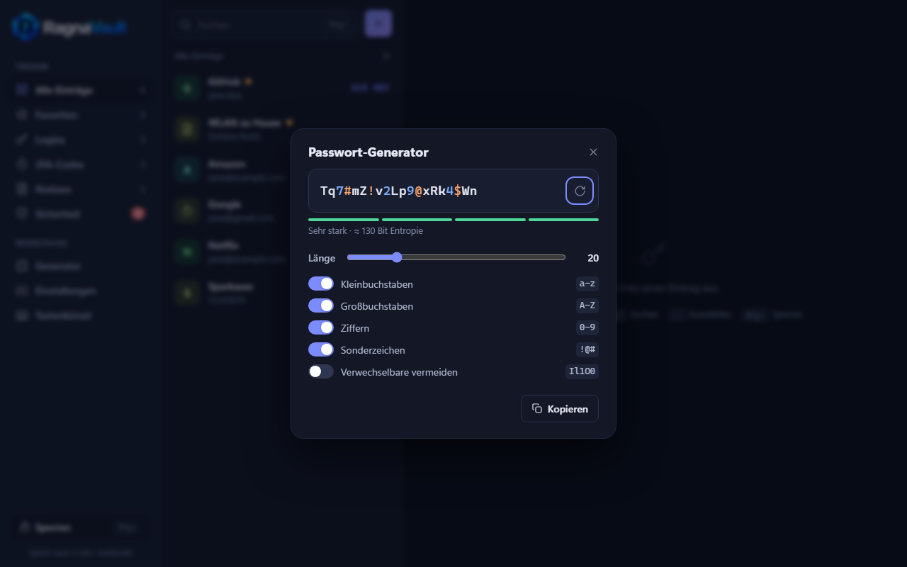
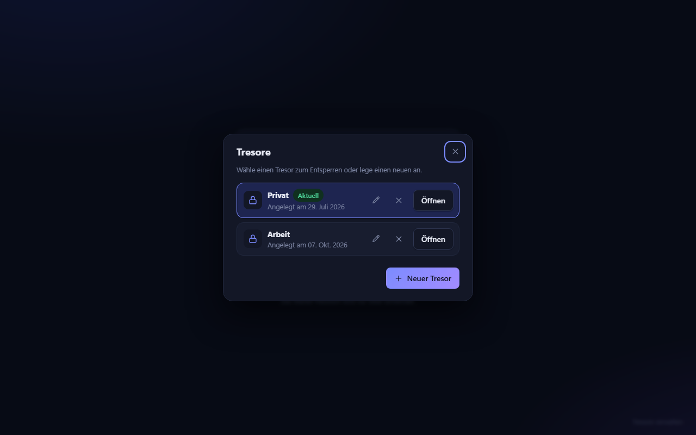
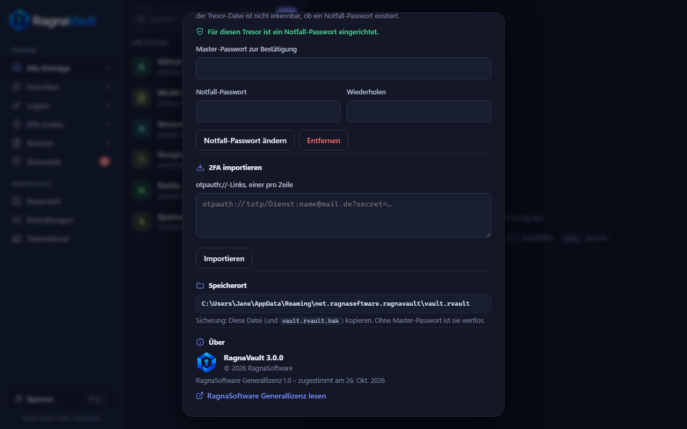
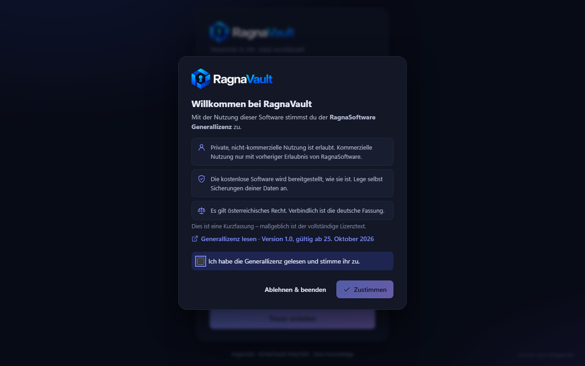
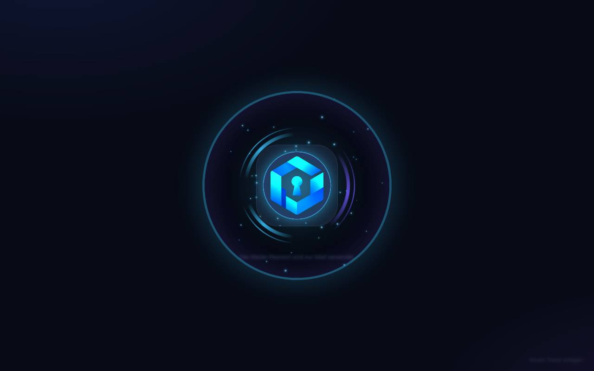

<p align="center">
  <picture>
    <source media="(prefers-color-scheme: dark)" srcset="src/logo-text-dark.png">
    
  </picture>
</p>

<p align="center">
  <b>Passwort-Manager und 2FA-Authenticator für Windows – lokal, verschlüsselt, ohne Konto.</b><br>
  von <a href="https://ragnasoftware.net">RagnaSoftware</a>
</p>

<p align="center">
  <a href="https://github.com/RagnaSoftware/RagnaVault/releases/latest"></a>
  
  
  <a href="https://ragnasoftware.net/lizenz/"></a>
</p>

<p align="center">
  <picture>
    <source media="(prefers-color-scheme: light)" srcset="docs/screenshots/uebersicht-hell.png">
    
  </picture>
</p>

---

## Download

Die aktuelle Version gibt es unter **[Releases](https://github.com/RagnaSoftware/RagnaVault/releases/latest)**:

| Datei | Wofür |
|---|---|
| `RagnaVault_3.0.0_x64-setup.exe` | Installer mit Startmenü-Eintrag und Deinstallation – wahlweise nur für dich oder für alle Benutzer |
| `RagnaVault_3.0.0_x64_portable.exe` | Einzelne exe ohne Installation, z. B. für einen USB-Stick |

Voraussetzung ist Windows 10 oder 11 (64 Bit). Die benötigte WebView2-Laufzeit ist bei Windows 11 dabei; der Installer lädt sie bei Bedarf automatisch nach.

> **Hinweis zu SmartScreen:** Die exe ist (noch) nicht code-signiert. Windows zeigt deshalb beim ersten Start eventuell „Der Computer wurde durch Windows geschützt“. Über **Weitere Informationen → Trotzdem ausführen** startet RagnaVault. Die SHA-256-Prüfsummen stehen in den Release-Notizen.

## Funktionen

**Tresor**
- Logins mit Benutzername, Passwort, Website und Notizen, sichere Notizen, eigenständige 2FA-Einträge
- Mehrere Tresore mit jeweils eigenem Master-Passwort – wählen, umbenennen und anlegen direkt am Sperrbildschirm
- Suche, Favoriten, Filter, Schnellkopie direkt aus der Liste, vollständige Tastaturbedienung
- Passwortverlauf: die letzten 10 Passwörter je Eintrag

**2FA-Authenticator**
- TOTP nach RFC 6238 (SHA-1/256/512, 6–8 Ziffern, frei wählbares Intervall) mit Live-Countdown
- Import per `otpauth://`-Link – einzeln im Editor oder viele auf einmal; Code-Vorschau beim Eingeben des Secrets

**Sicherheit**
- Sicherheitsbericht: schwache, mehrfach verwendete und alte Passwörter, Logins ohne 2FA
- Passwort-Generator ohne Modulo-Bias, mit Stärkeanzeige
- Zwischenablage wird nach einstellbarer Zeit geleert und landet nicht im Windows-Verlauf (Win + V)
- Automatische Sperre bei Inaktivität, optional beim Minimieren
- Fensterinhalt ist für Screenshots, Bildschirmaufnahmen und Fernwartung gesperrt (abschaltbar)
- Wachsende Wartezeit nach falschen Master-Passwörtern (2 s bis 5 min)
- **Notfall-Passwort (Duress) pro Tresor** – siehe unten

## Screenshots

| | |
|:---:|:---:|
| <br>**Entsperren** – mit Tresor-Auswahl unten rechts | <br>**Sicherheitsbericht** |
| <br>**Bearbeiten** – mit Stärkeanzeige und 2FA-Vorschau | <br>**Passwort-Generator** |
| <br>**Mehrere Tresore** | <br>**Einstellungen** – Notfall-Passwort, Über |
| <br>**Erster Start** – Zustimmung zur Generallizenz | <br>**Übergang** – die Lizenzkarte wird zur Tresortür |

<sub>Alle Screenshots zeigen Beispieldaten.</sub>

## So schützt RagnaVault deine Daten

```
Master-Passwort + Salt ──Argon2id (64 MiB, 3 Durchläufe)──► KEK
KEK ──XChaCha20-Poly1305──► verpackter DEK (32 Byte, einmalig zufällig erzeugt)
DEK ──XChaCha20-Poly1305──► Tresor-Inhalt
```

- **Zero-Knowledge:** Verschlüsselt wird ausschließlich auf dem Gerät. Das Master-Passwort wird nie gespeichert oder übertragen.
- **Kein Klartext-Orakel:** Ein falsches Passwort scheitert am Auth-Tag des verpackten DEK.
- **Manipulationsschutz:** Die Revision der Datei ist Teil der AAD des Inhalts und lässt sich nicht unbemerkt ändern.
- **Sicheres Speichern:** atomar über eine temporäre Datei, die vorige Version bleibt als `.bak`.
- **Wenig Angriffsfläche:** Die Oberfläche bekommt für die Liste nur Zusammenfassungen. Passwörter, Secrets und Notizen werden einzeln angefordert, Kopieren passiert direkt in Rust, angezeigte Passwörter verschwinden nach 20 s. Entschlüsselte Daten werden beim Sperren im Speicher überschrieben (`zeroize`). Strikte CSP, kein `innerHTML`; Links öffnen nur als `http`/`https` im Standardbrowser.
- **Master-Passwort ändern**, ohne den Tresor neu zu verschlüsseln (nur der DEK wird neu verpackt).

> Das Master-Passwort ist **nicht wiederherstellbar** – weder von dir noch von RagnaSoftware. Das ist Absicht.

### Notfall-Passwort (Duress)

Für den Fall, dass dich jemand zwingt, deinen Tresor zu öffnen: Gibst du statt des Master-Passworts das Notfall-Passwort ein, wird **der Tresor sofort unwiderruflich gelöscht** und ein leerer Tresor geöffnet.

- Jede Tresor-Datei enthält immer ein zweites Schlüssel-Fach. Ohne Notfall-Passwort ist es mit gleich langen Zufallsdaten gefüllt – ob eins existiert, ist der Datei nicht anzusehen.
- Beide Fächer hängen am selben Salt; ein Entsperrversuch kostet immer genau eine Argon2-Ableitung, egal welches Passwort passt.
- Tresor-Datei, Backup und Zwischenstände werden mit Zufallsdaten überschrieben und gelöscht.
- Grenzen: Auf SSDs garantiert Überschreiben nicht, dass alte Blöcke physisch verschwinden – und eine vorher kopierte Datei bleibt lesbar.

Einrichten unter **Einstellungen → Notfall-Passwort**, getrennt für jeden Tresor.

## Tastenkürzel

| Kürzel | Aktion | Kürzel | Aktion |
|---|---|---|---|
| `Strg F` | Suchen | `Strg C` | Passwort kopieren |
| `↑` `↓` | Eintrag wählen | `Strg B` | Benutzername kopieren |
| `Strg N` | Neuer Login | `Strg T` | 2FA-Code kopieren |
| `Strg E` | Bearbeiten | `Strg S` | Speichern (Editor) |
| `Strg G` | Generator | `Entf` | Löschen |
| `Strg L` | Sperren | `Esc` | Abbrechen |

## Daten und Sicherung

Alles liegt unter `%APPDATA%\net.ragnasoftware.ragnavault\`:

| Datei | Inhalt |
|---|---|
| `vaults.json` | Liste der Tresore (Namen, Dateinamen) |
| `vault.rvault`, `vault-<id>.rvault` | je ein verschlüsselter Tresor, daneben `.bak` als vorige Version |
| `license.json` | Zustimmung zur Generallizenz (Version, Zeitpunkt) |

Zur Sicherung einfach die `.rvault`-Dateien kopieren – ohne Master-Passwort sind sie wertlos.

## Selbst bauen

Voraussetzungen: [Rust](https://rustup.rs) (stable), [Node.js](https://nodejs.org), WebView2 (in Windows 10/11 enthalten).

```sh
npm install
npx tauri dev      # Entwicklungsmodus
npm test           # Rust-Tests, u. a. RFC-6238-Testvektoren und Duress
npx tauri build    # Release: portable exe + Installer
```

Ergebnis: `src-tauri/target/release/ragnavault.exe` und `src-tauri/target/release/bundle/nsis/RagnaVault_3.0.0_x64-setup.exe`.

> In PowerShell mit eingeschränktem Sprachmodus funktioniert `npm.ps1` nicht – dann `npx.cmd` verwenden oder Git Bash.

<details>
<summary><b>Projektaufbau</b></summary>

| Pfad | Inhalt |
|---|---|
| `src-tauri/src/crypto.rs` | Argon2id, XChaCha20-Poly1305, Schlüsseltypen |
| `src-tauri/src/vault.rs` | Dateiformat, Sitzung, Einträge, Notfall-Passwort |
| `src-tauri/src/vaults.rs` | Liste der Tresore |
| `src-tauri/src/totp.rs` | TOTP-Berechnung, otpauth-Parser |
| `src-tauri/src/generator.rs` | Passwort-Generator |
| `src-tauri/src/strength.rs` | Stärke-Schätzung für Anzeige und Bericht |
| `src-tauri/src/license.rs` | Zustimmung zur Generallizenz |
| `src-tauri/src/commands.rs` | Tauri-Befehle, Zwischenablage |
| `src-tauri/installer/` | Installer-Grafiken und Lizenztext |
| `src/` | Oberfläche (HTML/CSS/JS ohne Build-Schritt) |
| `assets/logo/` | Original-Logos |

Logos für die Oberfläche (`src/logo-*.png`) und die App-Icons (`src-tauri/icons/`, via `npx tauri icon`) werden aus `assets/logo/` erzeugt. `darkmode logo mit text.png` hat ein schwarzes „Ragna“ und wird im **hellen** Design verwendet.

</details>

## Lizenz

RagnaVault wird unter der **[RagnaSoftware Generallizenz](https://ragnasoftware.net/lizenz/)** (Version 1.0, gültig ab 25. Oktober 2026) bereitgestellt. Private, nicht-kommerzielle Nutzung ist erlaubt; kommerzielle Nutzung nur mit vorheriger Erlaubnis von RagnaSoftware. Verbindlich ist der vollständige deutsche Lizenztext.

Komponenten Dritter (u. a. Tauri, RustCrypto) unterliegen ihren eigenen Open-Source-Lizenzen.

© 2026 RagnaSoftware · [ragnasoftware.net](https://ragnasoftware.net)
